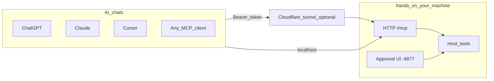

# hands-mcp

[](https://github.com/abhinavshyju/hands-mcp/actions/workflows/ci.yml)


**`hands`** is an MCP CLI and local daemon that gives **ChatGPT, Claude, Cursor, Cloud Code**, and any **MCP-capable chat** real tools on your machine: read, search, edit, run commands, git, browser automation, and human-in-the-loop approvals.

The chat app is the brain. **Hands** is the hands. There is no LLM inside the daemon—it exposes [Model Context Protocol](https://modelcontextprotocol.io/) over HTTP at `/mcp`.

## Demo

<video src="docs/assets/demo.mp4" controls width="100%">
  <a href="docs/assets/demo.mp4">Download demo video</a>
</video>

## Works with

- **ChatGPT** — remote MCP / connector settings (URL + bearer token)
- **Claude** — Desktop and apps with MCP support
- **Cursor** — MCP server config
- **Cloud Code chat** — custom MCP URL + bearer in your product’s MCP settings
- **Any MCP client** — `hands connect --client generic`

Step-by-step for each client: [docs/CONNECTORS.md](docs/CONNECTORS.md).

## How it works



## Requirements

- **Node.js** 20+
- **pnpm** 10.x
- Optional: [cloudflared](https://developers.cloudflare.com/cloudflare-one/connections/connect-networks/) for public URLs ([docs/TUNNEL.md](docs/TUNNEL.md))
- Optional: Chromium for browser tools (`npx playwright install chromium`)

## Install

```bash
git clone https://github.com/abhinavshyju/hands-mcp.git
cd hands-mcp
pnpm install
pnpm run install:global
```

Add `~/.local/bin` to your PATH if needed:

```bash
export PATH="$HOME/.local/bin:$PATH"
```

## Run

From any project directory:

```bash
hands .
```

This creates `~/.hands`, writes `.hands/config.json` in the project if missing, registers the workspace, starts the MCP server, and opens the interactive approval console.

Open the **observe-and-approve** UI at [http://127.0.0.1:4877](http://127.0.0.1:4877) (file tree, Monaco, diffs, audit log, terminal, checkpoints).

Headless or step-by-step:

```bash
hands init
hands workspace add .
hands start --no-tunnel
hands review    # approvals in another terminal
```

Inside this repo you can use `pnpm hands -- …`; elsewhere use the global `hands` binary.

Enable Tab completion: `eval "$(hands completion bash)"` (see [docs/CLI.md](docs/CLI.md)).

## Connect your chat (~60 seconds)

1. **Start the daemon** (if not already running):

   ```bash
   hands .
   ```

2. **Choose auth** (default `none` for local use; use **bearer** or **oauth** before a public tunnel):

   ```bash
   hands auth mode bearer   # or: none | oauth
   hands token new my-laptop   # when using bearer
   ```

3. **Print the MCP URL**:

   ```bash
   hands connect --client generic
   # or: hands connect --client claude
   # or: hands connect --client cursor
   ```

4. In your chat product’s **MCP / Connectors** settings, add:
   - **URL:** `http://127.0.0.1:4877/mcp` (or your tunneled `https://…/mcp`)
   - **Auth:** `Authorization: Bearer YOUR_TOKEN` when `auth.mode` is `bearer`, or OAuth discovery when `auth.mode` is `oauth` (see [docs/CONNECTORS.md](docs/CONNECTORS.md))

For a temporary public URL (no Cloudflare account):

```bash
hands tunnel quick
# or: hands . --tunnel-quick
```

Full recipes: [docs/CONNECTORS.md](docs/CONNECTORS.md). Stable hostname: [docs/TUNNEL.md](docs/TUNNEL.md).

## Why Hands

- **Safety modes** — `readonly`, `review` (approve edits/shell), `auto` (still jailed and denylisted)
- **Path jail** — workspace-only paths; blocks secrets and sensitive dotfiles
- **Shadow-git checkpoints** — restore file snapshots without touching your repo `HEAD`
- **Rich tools** — read/search/edit, processes, git, quality helpers, Playwright browser tools
- **Custom plugins** — drop tools in `~/.hands/tools/` ([docs/PLUGINS.md](docs/PLUGINS.md))

Details: [docs/SAFETY.md](docs/SAFETY.md), [docs/THREAT-MODEL.md](docs/THREAT-MODEL.md).

## Tools

See [docs/TOOLS.md](docs/TOOLS.md) for the full tool reference.

## Documentation

| Doc                                                | Topic                                            |
| -------------------------------------------------- | ------------------------------------------------ |
| [docs/CLI.md](docs/CLI.md)                         | All `hands` commands                             |
| [docs/CONNECTORS.md](docs/CONNECTORS.md)           | ChatGPT, Claude, Cursor, Cloud Code, generic MCP |
| [docs/TUNNEL.md](docs/TUNNEL.md)                   | Cloudflare quick, token, and named tunnels       |
| [docs/TOOLS.md](docs/TOOLS.md)                     | MCP tool catalog                                 |
| [docs/SAFETY.md](docs/SAFETY.md)                   | Modes, jail, approvals, checkpoints              |
| [docs/PLUGINS.md](docs/PLUGINS.md)                 | Custom tools                                     |
| [docs/TROUBLESHOOTING.md](docs/TROUBLESHOOTING.md) | Common issues                                    |
| [docs/GITHUB.md](docs/GITHUB.md)                   | Default branch and repo settings                 |
| [docs/MCP-IDE.md](docs/MCP-IDE.md)                 | MCP IDE fork integration                         |
| [docs/THREAT-MODEL.md](docs/THREAT-MODEL.md)       | Security notes                                   |

## Repository layout

```
packages/shared   zod schemas
packages/core     jail, edits, checkpoints, search, processes, approvals, tunnel
packages/tools    MCP tool implementations + plugin loader
packages/server   Fastify + MCP Streamable HTTP + control API
packages/cli      hands binary
apps/ui           React approval UI
```

## Development

```bash
pnpm check    # lint, format check, typecheck, test
pnpm format   # Prettier (also on save if you use the recommended VS Code extension)
pnpm test
pnpm build
```

Open the repo in Cursor/VS Code and install the recommended **Prettier** extension (`.vscode/extensions.json`) for format-on-save.

CI runs on push/PR to `main` via [.github/workflows/ci.yml](.github/workflows/ci.yml).

Contributions welcome—see [CONTRIBUTING.md](CONTRIBUTING.md) and run `pnpm check` before opening a PR.

## Upgrading from editer

If you used the previous **`editer`** CLI and `~/.editer` layout:

1. Stop any running daemon (`editer stop` or kill the old process).
2. Install the new binary: `pnpm run install:global` (provides `hands`).
3. On first run, **Hands** renames `~/.editer` → `~/.hands` and project `.editer` → `.hands` when the new paths do not exist yet.
4. Re-paste MCP settings from `hands connect` (connector JSON key is now `hands`, not `editer`).
5. Remove the old shim at `~/.local/bin/editer` if you no longer need it.

## License

[MIT](LICENSE)

## Related

[hands-mcp](https://github.com/abhinavshyju/hands-mcp) can be embedded as a git submodule in **MCP IDE** (a Code-OSS workbench that supervises the daemon). See [docs/MCP-IDE.md](docs/MCP-IDE.md).
