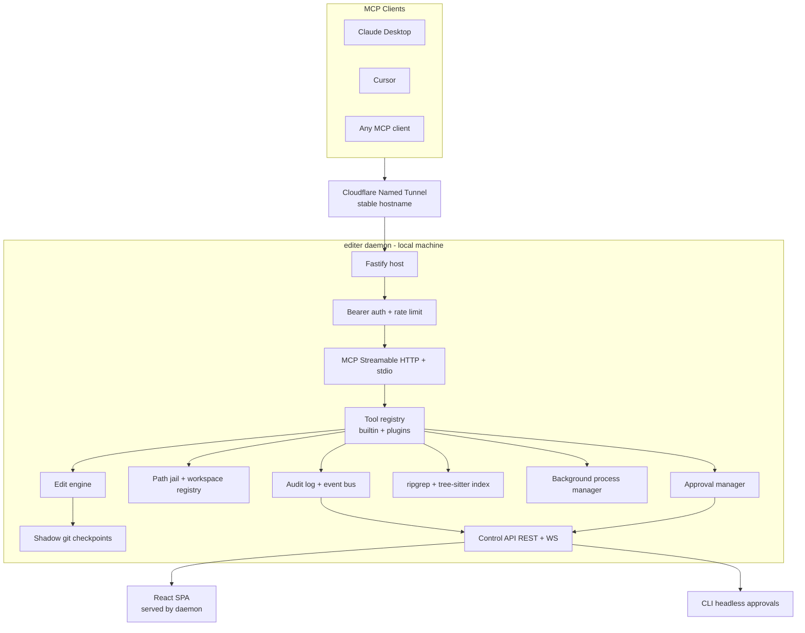

# hands-mcp — Project Plan

A local coding-agent daemon exposed over MCP. Any MCP-capable chat client (Claude Desktop, Cursor, etc.) connects to a stable Cloudflare-tunneled HTTPS endpoint and gets Cursor-style tools — read, search, edit, run, git, background processes — executed on this machine. Ships with a browser-based code-editor UI for diff review, approvals, and undo, plus a fully headless mode.

The connected chatbot is the brain. This project is the hands. There is no LLM inside the daemon.

---

## 1. Locked decisions

- **Topology:** daemon runs locally, started by the `editer` CLI or the app we build; reachable publicly through a Cloudflare **named** tunnel (stable hostname).
- **Tool surface:** Cursor-like, high-level down to low-level primitives.
- **Stack:** TypeScript end to end. pnpm monorepo. Node daemon (MCP SDK + Fastify) + React/Vite UI.
- **Edits:** deterministic only — `write_file`, `str_replace` (exact, unique match), `apply_patch` (unified diff), `multi_edit`. No LLM fast-apply.
- **Search:** ripgrep + tree-sitter symbol index. Semantic/embedding search deferred behind the same interface.
- **Safety:** three modes per workspace — `readonly` / `review` / `auto`. Shell defaults to `review` (approve), edits to `auto` (allow). In `auto`, edits and shell both allow; denylist + path jail still apply. Path jail + denylist + checkpoints always on.
- **UI:** daemon serves a React SPA on localhost (and over the tunnel). Scope is observe-and-approve: file tree, Monaco viewer, live diff review, audit log, terminal stream, checkpoint timeline, status. Tauri wrapper is Phase 2.
- **Auth:** static rotatable bearer tokens, per-client. OAuth 2.1 is Phase 2 (needed only for ChatGPT connectors).
- **Workspaces:** registry of allowed roots; `list_workspaces` / `set_active_workspace`; every path resolved and jailed against the chosen root.
- **Undo:** shadow git repo under `.editer/`, snapshotting touched files before each mutating call. Never touches the user's branches, index, or stash.
- **Processes:** background process manager so dev servers and watchers don't hang a tool call.
- **Extensibility:** drop-in TS modules in `~/.editer/tools/` exporting `{ name, description, schema, handler }`, hot-reloaded through the same registry as built-ins.
- **Rigor:** Vitest on the dangerous core (path jail, patch apply, checkpoint restore, approval gating, auth) + one end-to-end MCP client smoke test. GitHub Actions CI.

## 2. Architecture



Every mutating tool call follows one path: resolve and jail the path, consult the mode, raise an approval if required, snapshot to a checkpoint, apply, emit an audit event.

## 3. Repo layout

```
hands-mcp/
├── package.json              # pnpm workspace root
├── pnpm-workspace.yaml
├── tsconfig.base.json
├── plan.md
├── packages/
│   ├── shared/               # zod schemas + types shared by daemon, CLI, UI
│   ├── core/                 # config, workspace registry, path jail, edit engine,
│   │                         # checkpoints, search, process manager, approvals, audit
│   ├── tools/                # tool registry, built-in tools, plugin loader
│   ├── server/               # Fastify host, MCP transports, auth, control API, SPA serving
│   └── cli/                  # `editer` binary, tunnel wizard, headless mode
└── apps/
    └── ui/                   # React + Vite + Monaco SPA
```

## 4. Tool catalog

Grouped, each with a zod schema and a declared `mutating` / `readonly` classification that drives the approval gate.

- **Meta:** `get_capabilities`, `get_config`, `list_workspaces`, `set_active_workspace`, `get_project_overview`
- **Read:** `read_file` (line ranges), `read_many_files`, `list_dir`, `file_stat`
- **Search:** `grep_search`, `glob_search`, `list_symbols`, `find_symbol_definition`, `find_references`
- **Edit:** `write_file`, `create_file`, `str_replace`, `multi_edit`, `apply_patch`, `delete_path`, `move_path`
- **Exec:** `run_command` (sync + timeout), `start_process`, `list_processes`, `read_process_output`, `stop_process`
- **Git:** `git_status`, `git_diff`, `git_log`, `git_branch`, `git_commit`
- **Checkpoints:** `list_checkpoints`, `diff_checkpoint`, `restore_checkpoint`
- **Quality:** `run_tests`, `run_lint`, `run_build` (resolved from `package.json` scripts / detected toolchain)
- **High-level:** `scaffold_project` (template-driven), `install_packages` (detected package manager), `generate_image` (MCP sampling)
- **Browser:** `browser_navigate`, `browser_screenshot`, `browser_snapshot`, interactions, `browser_assert`, `browser_get_console`, session lifecycle

---

# 5. Todo list

Tasks are ordered and independently runnable. Each has an acceptance check; do not mark done until it passes.

## Phase 0 — Bootstrap

- [x] **T0.1 — Workspace skeleton.** pnpm workspace, root `package.json`, `pnpm-workspace.yaml`, `tsconfig.base.json` (strict, `noUncheckedIndexedAccess`), the six package dirs each with their own `tsconfig.json` and `package.json`.
      _Accept:_ `pnpm install && pnpm -r build` succeeds on empty stubs.
- [x] **T0.2 — Tooling.** ESLint (typescript-eslint, `no-floating-promises`, `no-explicit-any`), Prettier, Vitest config, `pnpm check` = lint + typecheck + test.
      _Partial:_ `no-floating-promises` is off in eslint.config.js.
- [x] **T0.3 — CI.** GitHub Actions running `pnpm check` on push and PR.
      _Accept:_ green run on the default branch.
- [x] **T0.4 — `packages/shared`.** Zod schemas and types for config, workspace, tool descriptor, audit event, approval request, checkpoint, process record. Single source of truth for daemon, CLI, and UI.
      _Partial:_ tool descriptor lives in `packages/tools/src/types.ts`, not shared.

## Phase 1 — Core safety primitives

- [x] **T1.1 — Config system.** Load and merge `~/.editer/config.json` (global: port, tokens, tunnel, plugin dir) with per-project `.editer/config.json` (mode, denylist, script overrides). Zod-validated, typed, defaults documented.
      _Accept:_ unit tests for merge precedence and invalid-config rejection.
- [x] **T1.2 — Workspace registry.** Add/remove/list roots, persist to global config, track the active workspace. Registration happens via CLI or UI only — never via an MCP tool.
      _Accept:_ registry survives restart; a tool cannot add a root.
- [x] **T1.3 — Path jail.** `resolvePath(workspace, input)` returning an absolute path or throwing. Handles `..`, absolute inputs, symlinks (realpath both sides), Windows-style separators, and a denylist (`.git/config`, `.env*` read gating, `~/.ssh`, `~/.aws`, `node_modules` write gating).
      _Accept:_ **critical** test suite — a table of traversal and symlink-escape attempts, all rejected.
- [x] **T1.4 — Audit log + event bus.** Append-only JSONL per day under `~/.editer/logs/`, plus an in-process typed event emitter that the control API subscribes to. Secret redaction pass on all logged values.
      _Accept:_ a tool call produces one audit record; a token in an argument is redacted.

## Phase 2 — MCP server skeleton

- [x] **T2.1 — Fastify host.** HTTP server bound to configurable host/port, graceful shutdown, structured logging, `/healthz`.
      _Accept:_ `curl /healthz` returns 200.
- [ ] **T2.2 — Bearer auth.** Per-client named tokens, constant-time compare, auth required on MCP and control routes, token identity attached to every audit event. Localhost UI exempt via a loopback-only session cookie.
      _Gap (next, security-sensitive):_ HTTP hook in `packages/server/src/auth.ts` currently stamps `clientName = "mcp"` and never returns 401. Token store exists; enforcement does not. Do this before exposing the tunnel.
      _Accept:_ tests for missing, wrong, and revoked tokens; identity appears in the audit log.
- [x] **T2.3 — MCP transports.** `@modelcontextprotocol/sdk` server over Streamable HTTP at `/mcp` with session management, plus a stdio entrypoint for same-machine clients. Server info, protocol version, capability negotiation.
      _Accept:_ MCP Inspector connects over both transports and lists tools.
- [x] **T2.4 — Tool registry.** Central registry: `name`, `description`, zod input schema (converted to JSON Schema for MCP), `mutating` flag, `requiredMode`, handler. Uniform error envelope so a thrown error becomes a readable tool error, never a crash.
      _Accept:_ a deliberately throwing fixture tool returns a clean MCP error; the process stays up.
- [x] **T2.5 — `get_capabilities` + `get_config`.** First real tools: report version, mode, active workspace, available tool groups, limits.
      _Accept:_ a chat client can call them and describe the daemon's state.

## Phase 3 — Read and search

- [x] **T3.1 — Read tools.** `read_file` (optional line range, byte cap with truncation notice, binary detection), `read_many_files`, `list_dir` (depth limit, gitignore-aware), `file_stat`.
      _Accept:_ reading outside the jail fails; a 10 MB file returns a truncated result rather than exploding.
- [x] **T3.2 — Ripgrep integration.** Vendor `@vscode/ripgrep`. `grep_search` with regex, glob include/exclude, case flags, context lines, match caps. `glob_search` for filename patterns.
      _Partial:_ shells out to system `rg` rather than vendoring `@vscode/ripgrep`.
- [x] **T3.3 — Tree-sitter symbol index.** Parsers for TS/JS/TSX, Python, Go, Rust, Java. Extract definitions into SQLite, incremental reindex on mtime change, in-memory cache. Powers `list_symbols`, `find_symbol_definition`, `find_references` (symbol index + lexical fallback).
      _Partial:_ regex extractors + sql.js, not tree-sitter parsers.
- [x] **T3.4 — `get_project_overview`.** Cheap orientation for a fresh chat: detected languages, package manager, scripts, entrypoints, top-level tree, README excerpt.
      _Accept:_ one call gives a chatbot enough to plan without ten exploratory calls.

## Phase 4 — Edit engine and checkpoints

- [x] **T4.1 — Shadow git checkpoints.** Initialize a bare git dir at `.editer/shadow.git` with the workspace as work-tree, isolated via `GIT_DIR`/`GIT_INDEX_FILE` so the user's repo state is untouched. Snapshot touched files before each mutating call; record a checkpoint with id, timestamp, tool, client, and file list.
      _Accept:_ **critical** test — mutate, restore, confirm byte-identical recovery; confirm the user's `git status`, `HEAD`, and index are unchanged throughout.
- [x] **T4.2 — Edit engine.** `write_file`, `create_file` (fails if exists), `delete_path`, `move_path`. Atomic writes via temp file + rename. Preserve existing line endings and trailing-newline convention. Enforce file-size and count limits.
      _Partial:_ no dedicated interrupted-write test.
- [x] **T4.3 — `str_replace`.** Exact match; errors with context if the needle is missing or appears more than once; `expected_occurrences` for intentional multi-replace; returns a diff of what changed.
      _Accept:_ **critical** test — ambiguous match rejected rather than guessed.
- [x] **T4.4 — `apply_patch`.** Unified diff application with strict hunk verification, multi-file patches, all-or-nothing semantics, actionable rejection messages.
      _Accept:_ **critical** test — a patch whose context drifted is rejected and the file is untouched.
- [x] **T4.5 — `multi_edit`.** Several `str_replace` operations on one file in a single transaction; sequential application; full rollback if any step fails.
      _Accept:_ a failing third edit leaves the file exactly as it started.
- [x] **T4.6 — Checkpoint tools.** `list_checkpoints`, `diff_checkpoint`, `restore_checkpoint` (whole checkpoint or selected files).
      _Accept:_ a chat client can undo its own last change.

## Phase 5 — Modes and approvals

- [x] **T5.1 — Mode engine.** Resolve the effective policy from workspace mode, per-tool-group overrides, and the tool's `mutating` flag into `allow` / `approve` / `deny`. `readonly` denies all mutation; `review` approves shell by default; `auto` allows edits and shell (no approval prompt). Denylist still applies.
      _Accept:_ **critical** policy matrix test across all three modes and both tool classes.
- [x] **T5.2 — Approval manager.** Pending-request queue; the tool call awaits resolution with a configurable timeout (default 120 s, denied on expiry); requests carry a human-readable summary and a diff or command preview; decisions are audited.
      _Accept:_ a call blocks, resolves on approve, returns a clear denial on reject and on timeout.
- [x] **T5.3 — Approval surfaces.** Deliver requests to connected UI clients over WebSocket, to the CLI as an interactive prompt in headless-attended mode, and optionally to a configured webhook. Auto-deny when no surface is attached and the mode requires approval.
      _Partial:_ `approvalWebhookUrl` is schema-only; no delivery code.
- [x] **T5.4 — Command policy.** Denylist of destructive patterns (`rm -rf /`, disk writes, `curl | sh`, fork bombs), optional allowlist mode, per-workspace overrides.
      _Accept:_ denylisted commands are refused even in `auto` mode.

## Phase 6 — Execution

- [x] **T6.1 — `run_command`.** Spawn with `cwd` jailed to the workspace, scrubbed environment (no daemon tokens leaked to children), timeout, output caps with truncation notice, exit code, combined and separated stdout/stderr.
      _Accept:_ a command that runs forever is killed at the timeout and reports partial output.
- [x] **T6.2 — Background process manager.** `start_process` returns a handle immediately; ring-buffered log capture; `list_processes`, `read_process_output` (offset-based incremental reads), `stop_process` (SIGTERM then SIGKILL). Port detection for dev servers. All children reaped on daemon shutdown.
      _Accept:_ a chatbot starts a Vite dev server, reads the printed local URL, then stops it; no orphan processes remain.
- [x] **T6.3 — Quality + scaffolding tools.** `run_tests`, `run_lint`, `run_build` resolved from detected scripts with parsed summaries. `install_packages` using the detected package manager. `scaffold_project` from a small template set.
      _Accept:_ `run_tests` on a fixture repo returns a structured pass/fail summary rather than raw noise.
- [x] **T6.4 — Git tools.** `git_status`, `git_diff`, `git_log`, `git_branch`, `git_commit` — read-only ones always available, `git_commit` and branch mutation gated through the approval engine.
      _Partial:_ no branch-create tool; `git_commit` is treated as an edit (allow in review/auto).

## Phase 7 — Control API

- [x] **T7.1 — REST surface.** Daemon state, workspaces, tool list, config read/update, checkpoints, processes, audit log query, token management.
      _Partial:_ token management is CLI-only, not REST.
- [x] **T7.2 — WebSocket stream.** Live events: tool call started/finished, approval requested/resolved, file changed, process output, checkpoint created, client connected. Replay buffer so a late-joining UI isn't blind.
      _Accept:_ opening the UI mid-session shows recent history and then live events.
- [x] **T7.3 — Diff service.** On-demand diffs: checkpoint vs working tree, before vs after for a given tool call, per-file hunks ready for the UI's diff viewer.
      _Accept:_ every mutating call in the audit log can render its own diff.

## Phase 8 — Editor UI

- [x] **T8.1 — App shell.** Vite + React + TypeScript + Tailwind, routing, REST/WS client generated from `shared` types, loopback session auth, dark theme, connection-state handling.
      _Partial:_ no router; no loopback session cookie (auth is off).
- [x] **T8.2 — File tree + Monaco viewer.** Lazy-loading gitignore-aware tree, tabbed read-only Monaco with syntax highlighting, badges on agent-touched files.
      _Partial:_ tree is not gitignore-aware; single viewer, client-side touched set.
- [x] **T8.3 — Diff review and approvals.** Monaco side-by-side diff for pending edits; approve/reject with reason; command preview for shell approvals; keyboard shortcuts; a queue when several pile up.
      _Partial:_ first pending only; no keyboard shortcuts.
- [x] **T8.4 — Activity log.** Chronological tool-call feed with client identity, duration, arguments, result summary, inline diff expansion, filtering and search.
      _Accept:_ the whole session is auditable without reading JSONL by hand.
- [x] **T8.5 — Terminal panel.** xterm.js rendering live output from `run_command` and each background process, one tab per process, with stop controls.
      _Partial:_ single xterm, not per-process tabs.
- [x] **T8.6 — Checkpoint timeline + status bar.** Browse checkpoints, preview a diff, restore whole or selected files with confirmation. Status bar shows mode, workspace, tunnel hostname and health, connected clients.
      _Accept:_ a bad change is reverted entirely from the UI.

## Phase 9 — CLI and headless

- [x] **T9.1 — `editer` binary.** Commander-based: `init`, `start`, `stop`, `status`, `logs`, `workspace add|list|remove`, `token new|list|revoke`, `mode set`.
      _Accept:_ `npx editer start` boots the daemon and prints the local URL, tunnel hostname, and tool count.
- [x] **T9.2 — Headless mode.** `--headless` serves no UI; approvals go to the CLI prompt when attached, or to a webhook, or auto-deny. `--mode` and `--no-tunnel` overrides. Suitable for a systemd unit.
      _Accept:_ runs with no browser involved; approval policy is explicit and logged.
- [x] **T9.3 — Connector config generator.** `editer connect --client claude|cursor|generic` prints the exact JSON or URL plus bearer token for that client, with copy-paste instructions.
      _Partial:_ output has no bearer token because HTTP auth is off (T2.2).

## Phase 10 — Cloudflare named tunnel

- [x] **T10.1 — cloudflared management.** Detect an installed `cloudflared`, otherwise download the correct platform binary into `~/.editer/bin` with checksum verification; version check.
      _Partial:_ download has no checksum verification.
- [x] **T10.2 — Named tunnel wizard.** `editer tunnel setup` walks `cloudflared tunnel login`, creates a named tunnel, writes credentials to `~/.editer/tunnel/`, prompts for the hostname, creates the DNS route, and generates the ingress config mapping the hostname to the local port.
      _Accept:_ one wizard run produces a stable `https://<host>/mcp` that survives daemon restarts.
- [x] **T10.3 — Lifecycle supervision.** Start cloudflared as a child of the daemon, parse its output for readiness, restart with backoff on drop, surface state to the UI, verify end-to-end by fetching `/healthz` through the public hostname on startup.
      _Partial:_ `verifyPublicHealth` exists but is not wired on startup.
- [ ] **T10.4 — Tunnel hardening.** Enforce bearer auth on all tunneled routes, rate limit per token, optionally gate the UI routes to loopback only, document putting Cloudflare Access in front.
      _Gap:_ rate limit is keyed by IP, not token; `exposeUiOverTunnel` is schema-only; auth is off (see T2.2). Do this together with T2.2.

## Phase 11 — Custom tools

- [x] **T11.1 — Plugin loader.** Scan `~/.editer/tools/` and `.editer/tools/`, load modules exporting `{ name, description, schema, handler }`, validate against the descriptor schema, register through the same path as built-ins, isolate failures so one bad plugin can't take down the daemon.
      _Accept:_ a sample plugin appears in the chat client's tool list without a code change to the daemon.
- [x] **T11.2 — Hot reload.** Watch plugin dirs, reload on change, emit an MCP `tools/list_changed` notification, show load errors in the UI.
      _Partial:_ `pluginErrors` is on `/api/state` but not rendered in the UI.
- [x] **T11.3 — Authoring kit.** `editer tool new <name>` scaffolds a typed plugin; document the context object given to handlers (jailed fs, approval request, audit emit, process manager, active workspace); ship two or three real examples.
      _Accept:_ a new custom tool goes from idea to working in under ten minutes.
- [x] **T11.4 — MCP prompts and resources.** Expose workspace files as MCP resources and ship prompt templates (for example "build a feature in this repo") that pre-load the orientation the tools need.
      _Accept:_ a client that supports prompts can start a build with one selection.

## Phase 12 — Hardening and release

- [x] **T12.1 — Concurrency.** Per-file advisory locks, serialized checkpoint writes, bounded concurrent tool execution, multi-client session isolation.
      _Partial:_ MCP uses one global `"global-tool"` lock, not per-file.
- [x] **T12.2 — End-to-end smoke test.** A real MCP client in CI: connect, orient, create a small project, edit it, run a command, break something, restore a checkpoint.
      _Accept:_ one command verifies the whole path and runs in CI.
- [x] **T12.3 — Security review.** Re-audit path jail, token handling, child-process environment scrubbing, secret redaction, denylists, tunnel exposure. Write a threat model note.
      _Partial:_ `docs/THREAT-MODEL.md` exists; several documented controls (auth, exposeUiOverTunnel) are not enforced.
- [x] **T12.4 — Docs.** README (what it is, 5-minute quickstart), tunnel setup, per-client connector guides, full tool reference, safety model, custom tool authoring, troubleshooting.
      _Accept:_ a stranger can go from clone to a chatbot editing their code using docs alone.
- [x] **T12.5 — Packaging.** Build the UI into the server package, publish `editer` to npm with a bin entry, verify `npx editer` on a clean machine, tag a release.
      _Partial:_ local bin + UI sync exist; not published to npm.

## Phase 13 — Backlog (post v1)

- [ ] **T13.1** Tauri desktop wrapper around the same SPA — tray icon, autostart, native notifications for approvals.
- [ ] **T13.2** OAuth 2.1 with dynamic client registration, for ChatGPT connectors and other OAuth-only clients.
- [ ] **T13.3** Semantic codebase search behind the existing search interface (local ONNX embeddings first).
- [ ] **T13.4** MCP aggregation: proxy other MCP servers through this endpoint as namespaced tools.
- [ ] **T13.5** Container-sandboxed shell execution as an opt-in alternative to host execution.
- [ ] **T13.6** Multi-machine fleet: one hostname, several registered daemons, workspace routing.

## Phase 14 — Browser, media, image generation

- [x] **T14.1 — Auto mode.** `auto` allows exec/quality/highlevel/browser mutations with no approval prompt. Denylist still applies. UI labels spell out the three modes.
- [x] **T14.2 — MCP image content.** Tool results may include `_media`; the CallTool handler emits `{ type: "image" }` blocks under an inline size cap.
- [x] **T14.3 — BrowserManager.** Playwright Chromium sessions with console/error/network buffers, idle close, shutdown teardown, localhost-first navigation policy.
- [x] **T14.4 — Browser tools.** navigate, screenshot, snapshot, click/type/fill/select/press/scroll, wait_for, eval, get_console, assert, sessions, close.
- [x] **T14.5 — `generate_image`.** MCP sampling via `ToolContext.sampling`; `ImageSource` seam; distinct `SAMPLING_UNAVAILABLE` vs `SAMPLING_NOT_IMAGE` errors; writes through jail + checkpoint.
- [x] **T14.6 — UI.** Activity-feed screenshots via `/api/media`; browser session strip.

Next after this phase: **T2.2 + T10.4** (bearer auth and tunnel hardening). Do not treat the tunnel as production-ready until those land.

---

## 6. Risks

- **Clients that only speak stdio.** Not every chat client supports remote HTTP MCP. Mitigated by shipping the stdio entrypoint from T2.3 and documenting `mcp-remote` as a bridge.
- **Chat models producing bad patches.** The deterministic edit engine rejects rather than guesses. The cost is occasional retries; the benefit is never silently mangling a file. Rejection messages must be good enough for a model to self-correct (T4.3, T4.4).
- **Approval blocking versus client timeouts.** Clients may time out a tool call before a human responds. Default approval timeout stays below typical client limits, and the denial message tells the model to retry.
- **Tunnel is an RCE surface.** Bearer auth, rate limiting, loopback-only UI by default, command denylist, and documented Cloudflare Access are all load-bearing, not optional polish.
- **Shadow git interfering with the real repo.** Strict `GIT_DIR`/`GIT_INDEX_FILE` isolation plus an explicit test that the user's repo state never moves (T4.1).
